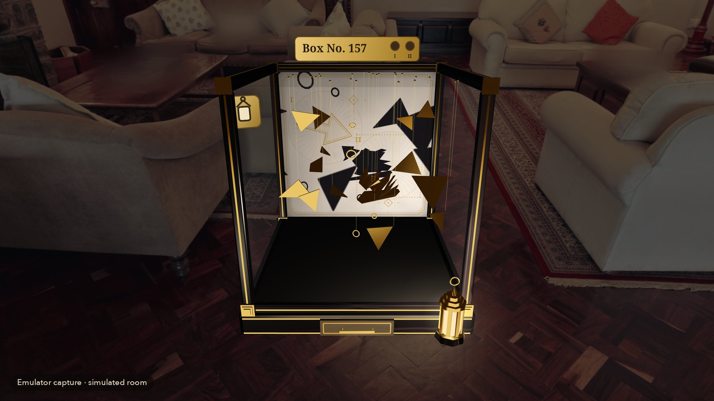
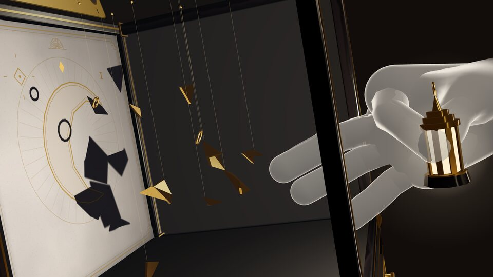
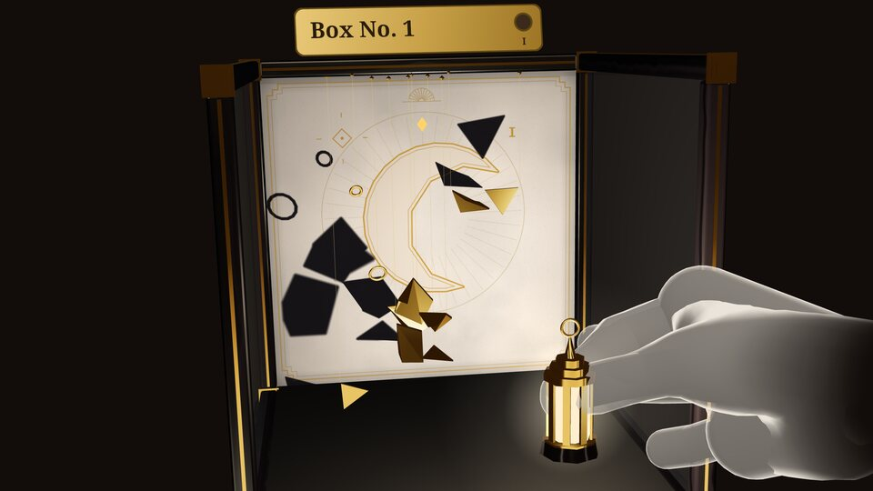
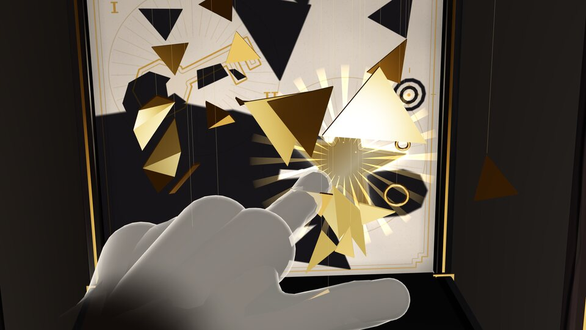
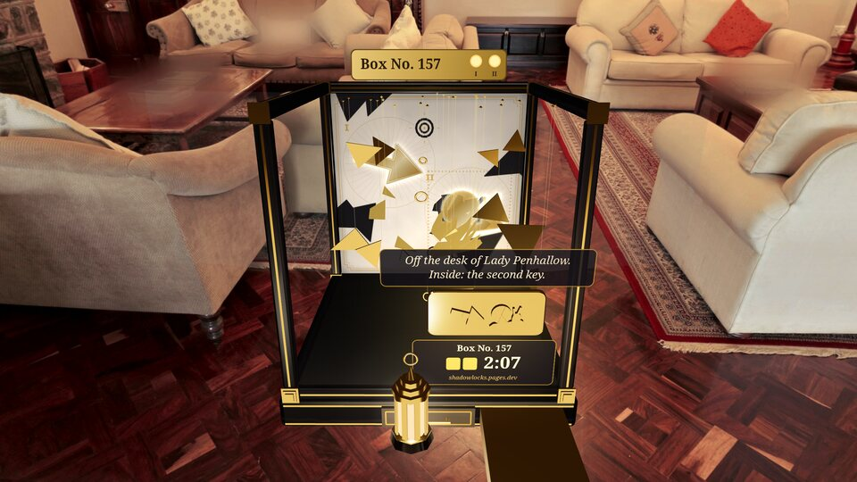
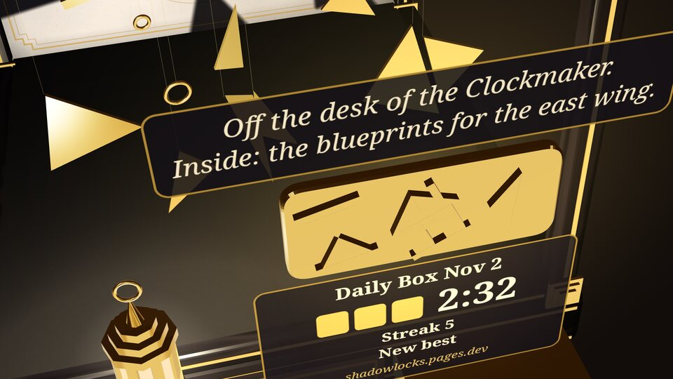
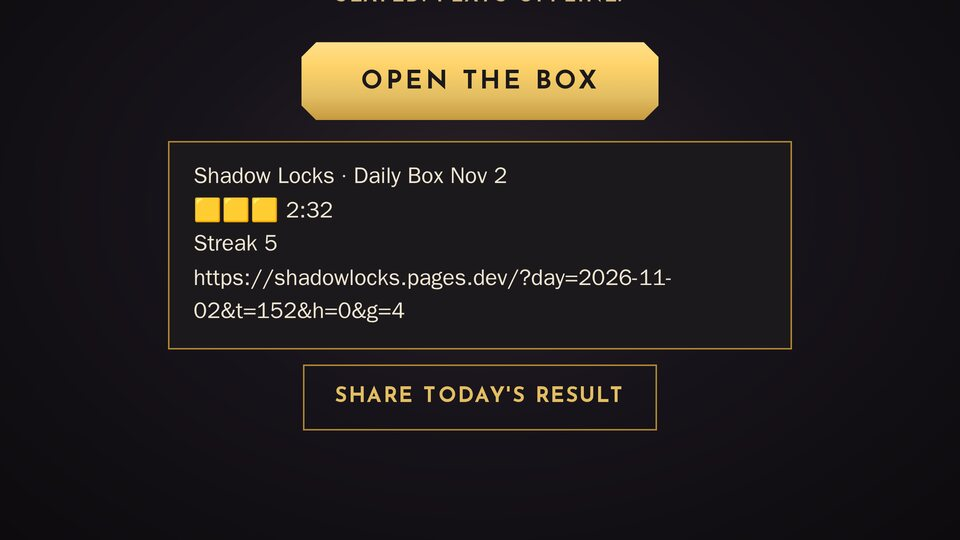
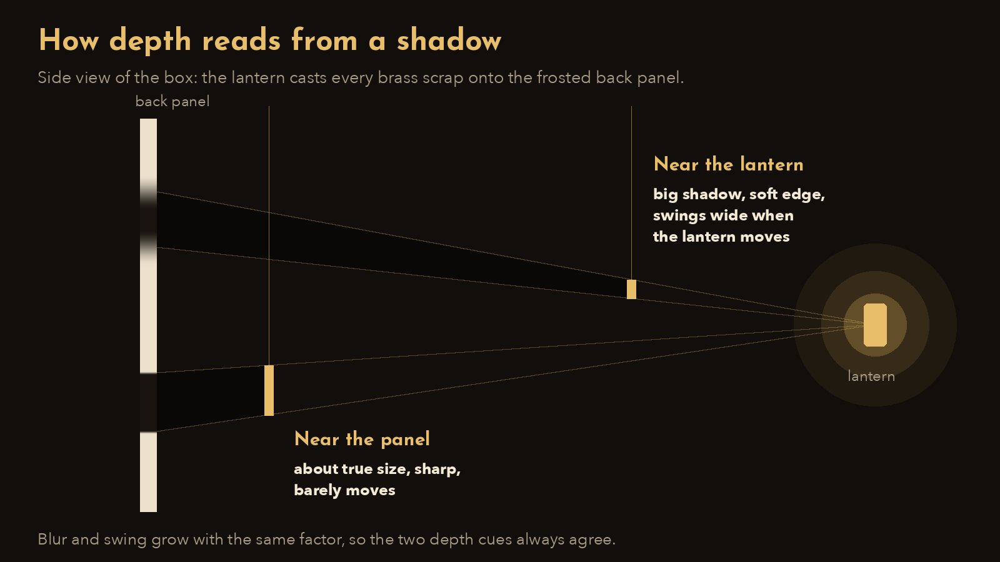
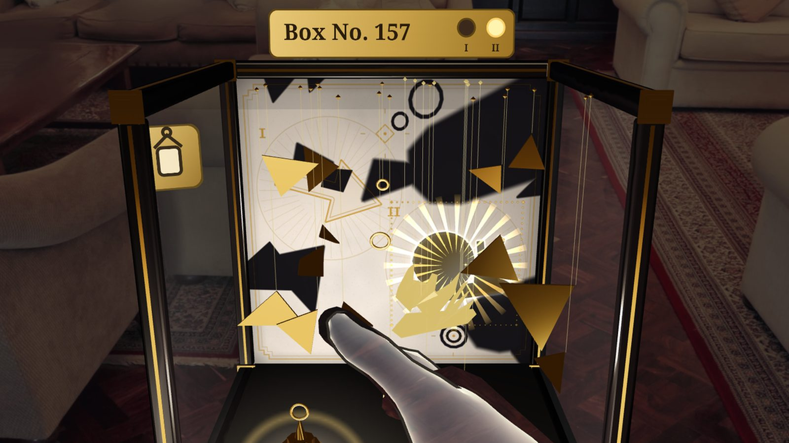
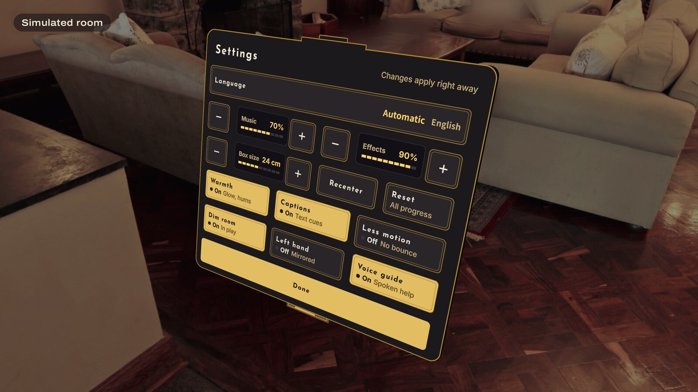

<p align="center">
  <a href="https://youtu.be/Ak_oFJQgHYg"></a>
</p>

<h1 align="center">Shadow Locks</h1>

<p align="center">
  <b>Infinite hand-tracked mixed reality puzzles for Meta Quest.</b><br>
  Carry a lantern, read depth from the shadows, and cast the missing piece with your own fingertip.
</p>

<p align="center"><sub>Meta VR Start Developer Competition 2026 · Gaming track · New</sub></p>

<p align="center">
  <a href="https://shadowlocks.pages.dev"></a>
  <a href="https://youtu.be/Ak_oFJQgHYg"></a>
</p>

<p align="center">
  
  
  
  
  
</p>

**Shadow Locks is an infinite mixed reality puzzle game for Meta Quest.** In passthrough, with a puzzle box in your
lap, you carry a lantern with your hands until the shadows of hanging brass scraps fill each lock. Scraps at different
depths cast shadows that grow, blur and swing by different amounts, so you read depth from the shadows to find the one
point in space that opens the lock. Some locks are one piece short, and your own fingertip in the beam casts the
missing piece.

### At a glance

- **Play:** [shadowlocks.pages.dev](https://shadowlocks.pages.dev) in the Meta Quest browser; no install, no account,
  offline after the first load; seated, and a box takes a few minutes
- **Core mechanics:** a lantern you hold freely in 3D, real-time shadow projection, depth read from blur and parallax,
  and your fingertip as a puzzle piece
- **Mixed reality:** passthrough; the room dims like a theatre while you solve; your real hand stays visible in front
  of the box
- **Input:** hand tracking first; Touch controllers do everything hands do, with haptics
- **Endless play:** infinite numbered boxes, plus a new Daily Box every day with a streak
- **With friends:** a result card for every box and "beat my time" links to the exact same box
- **Comfort and accessibility:** seated and one-handed, no fail state, a voice guide with every line also shown as text,
  left-hand mode, Less motion, box size 18 to 30 cm, six languages
- **Headsets:** Meta Quest 3 and Meta Quest 3S (asks for 90 Hz), Meta Quest 2 and Meta Quest Pro (asks for 72 Hz)
- **Tested:** 1,839 unit tests, plus 39 end-to-end specs that play the game in Meta's IWER headset emulator
- **Stack:** TypeScript, Meta's Immersive Web SDK (IWSDK), three.js, WebXR

### Why it's different

| Area | Shadow Locks |
|---|---|
| Innovation and creativity | You move the light, not the object; depth is read from shadow blur and parallax; your own fingertip is a puzzle piece ([How depth works](#how-depth-works)) |
| Experience design | Seated and hands first, the box in your lap in passthrough; Lesson 1 starts by itself with a ghost hand and a voice guide; a Daily Box and streak to come back to ([The first five minutes](#the-first-five-minutes)) |
| Technical implementation | Exact soft shadows projected on the CPU, real-hand occlusion in passthrough, a deterministic generator in a Web Worker, 2.2 to 2.8 ms of JavaScript per frame at 4× CPU throttle in tests ([How it is built](#how-it-is-built)) |
| Polish and presentation | A music-box score and effects tuned to G major, six languages, result cards and beat-my-time links, offline play ([Features](#features)) |

## Screenshots

<table>
  <tr>
    <td width="33%"><br><sub><b>Read depth from the shadows</b></sub></td>
    <td width="33%"><br><sub><b>Carry the light</b></sub></td>
    <td width="33%"><br><sub><b>Your fingertip is the missing piece</b></sub></td>
  </tr>
  <tr>
    <td width="33%"><br><sub><b>Open every lock: a reward and your time</b></sub></td>
    <td width="33%"><br><sub><b>A new Daily Box every day</b></sub></td>
    <td width="33%"><br><sub><b>Challenge a friend</b></sub></td>
  </tr>
</table>

<sub>Emulator captures from the game itself; the room shots use a photographed room in place of passthrough. Click the
picture at the top for the 85-second demo video.</sub>

<details>
<summary><b>Contents</b></summary>

- [Play it in two minutes](#play-it-in-two-minutes)
- [Why we made it](#why-we-made-it)
- [How depth works](#how-depth-works)
- [The first five minutes](#the-first-five-minutes)
- [Features](#features)
- [Comfort and accessibility](#comfort-and-accessibility)
- [Controls](#controls)
- [Meta Quest capabilities used](#meta-quest-capabilities-used)
- [How it is built](#how-it-is-built)
- [Frame rate and optimisations](#frame-rate-and-optimisations)
- [Built for real life: the edge cases it handles](#built-for-real-life-the-edge-cases-it-handles)
- [Challenges and what we learned](#challenges-and-what-we-learned)
- [Roadmap](#roadmap)
- [Run it yourself](#run-it-yourself)
- [Project layout](#project-layout)
- [Privacy](#privacy), [Credits](#credits), [Licence](#licence)

</details>

## Play it in two minutes

1. Sit down. Use your hands, or Touch controllers.
2. Open [shadowlocks.pages.dev](https://shadowlocks.pages.dev) in the Meta Quest browser and press **Open the box**.
   The first launch downloads about 11 MB; after that it plays offline.
3. Lesson 1 starts by itself, and a voice guide says what to do.
4. Pinch the lantern and move it until the shadows fill the gold outline. Let go any time: the lantern stays where you
   leave it.
5. Near scraps swing more and blur; far ones stay sharp. Use that to find the spot.
6. A lock that is one piece short: point one finger into the gap in the beam and hold still.
7. Stuck? Poke the little lantern on the frame for a hint, or choose Show me.
8. The Daily Box opens after Box No. 3.

From a phone or computer, the page offers **Open on my Meta Quest** (Meta's Web Launch), which sends the game to your
headset.

## Why we made it

- **Two things only a headset gives you:** a light you can hold anywhere in space, and your real hand in its beam.
  Shadow puppets and wooden puzzle boxes meet exactly there.
- **The light moves, and the answer is a point in space.** In most shadow puzzles you turn an object in front of a
  fixed light. Here you carry the light itself through 3D, read depth from the shadows, and the solution is a spot in
  the air you have to find.
- **The airplane seat test.** Everything works sitting down, with the box in your lap or on a tray table, every move
  small enough that your elbow can rest.
- **A small daily habit.** Like a daily word puzzle: a few minutes is a satisfying session, there is a reason to come
  back tomorrow, and a result you can send a friend without spoiling the answer.

## How depth works



With the lantern a distance D from the back panel, a scrap a distance d from it, a lantern of radius r, and the lantern
moved sideways by Δ:

$$
\text{shadow scale} = \frac{D}{D-d}, \qquad
\text{shadow swing} = \Delta \cdot \frac{d}{D-d}, \qquad
\text{edge blur} = r \cdot \frac{d}{D-d}
$$

A scrap at the panel casts its true size, sharp, and barely moves; a scrap halfway to the lantern casts a shadow twice
its size with a soft edge and swings as far as the lantern moves. Blur and swing share one factor, so the two depth
cues always agree. The blur is the same formula as `penumbra()` in `src/render/shadow-mesh.ts`.

## The first five minutes

- Lesson 1 starts on its own, and its first line is the goal: "Pick up the lantern.", then "Move the lantern until the
  shadow fills the moon."
- A pale blue ghost hand, animated from recorded poses, shows each new idea on a twin of the lock, then it is your turn.
- A voice guide reads each line aloud (English, on by default); every line is also shown as text in your language.
- If nothing moves for a while, short help lines appear where you are already looking, and a little lantern on the
  frame gives hints, up to showing the spot.
- Lesson 2 teaches the fingertip and the drawer menu. Every example and tip can be replayed from the drawer any time.

## Features

### Puzzle

- A lantern you hold freely in 3D, with every shadow recast from it each frame.
- Depth read from blur and parallax ([how depth works](#how-depth-works)).
- Finger locks: your own fingertip casts the missing piece; hold still and it turns to brass.
- Every opened box gives a reward with a line of story for your Collection.



### Infinite boxes and the Daily Box

- Every box is generated from its number, so Box No. 157 is the same box for everyone, on every headset.
- Difficulty ramps up: one gentle lock first, then up to three locks per box, decoy scraps, locks without sight rings,
  hidden outlines where you guess the shape, and finger locks.
- Fair by construction: the generator throws away any layout that breaks the rules (each lock's scraps tile its outline
  from its spot, a finger lock is short exactly its missing piece, nothing else falls on a lock from its spot, the start
  solves nothing, every spot is within a seated comfort zone), and tests check boxes 1 to 200 and 30 Daily Boxes; an
  opt-in sweep builds boxes 10 to 2000 and a year of Daily Boxes.
- After Box No. 3, a new Daily Box every day, the same for everyone on the same date, with a streak.

### Sharing and friendly competition

- A result card for every opened box: your time, one square per lock (gold for solved alone, orange with a hint, red
  when shown), your best, and your Daily streak.
- In the headset the card is made to read well in a Quest screenshot. On the game's 2D page, Share sends it as a few
  lines of text (coloured squares, time, streak) with a "beat my time" link such as
  `https://shadowlocks.pages.dev/?box=157&t=152&h=0&g=4` (box, your time in seconds, hints used, generator version; a
  Daily Box uses `day=2026-11-16`).
- The link opens the exact same box as practice, so it never touches your friend's own progress (a new player does
  Lesson 1 first). When your friend finishes, their card shows both times.
- No accounts and no server: the challenge lives in the link.

### Mixed reality

- The box places itself in your lap from your seated posture, never moves on its own, and comes back in front of you
  with one pinch on the arrow, or Recenter.
- Leaving, taking the headset off or reloading resumes the box where you were.

## Comfort and accessibility

Seated, one-handed, no fail state and no countdown; a voice guide with every line also shown as text; left-hand mode;
Less motion; box size 18 to 30 cm; six languages; every action works with hands or Touch controllers. Every solution
spot is generated at sternum height or lower and within 60 cm of your chest, so no move needs a raised or stretched arm.

### Settings

Settings opens from the drawer at the front of the box. Every change applies at once and is saved.



| Setting | What it does |
|---|---|
| Language | Automatic (follows the headset) or any of English, Spanish, French, German, Brazilian Portuguese and Japanese |
| Music, Effects | Volume of each, down to off |
| Box size | 18 to 30 cm |
| Warmth | The "getting closer" glow and hum as the lantern nears a lock's spot; switch it off for a purer puzzle |
| Less motion | No bounce in the animations |
| Dim room | The theatre dimming of your room while you solve |
| Left hand | Mirrors the box and the lessons |
| Voice guide | Spoken help in English, on by default |
| Recenter | Places the box in front of you again |
| Reset progress | Starts over, after asking first |

## Controls

| Action | Hands | Touch controllers |
|---|---|---|
| Pick up the lantern | Pinch it | Hold the trigger or grip on it |
| Move the lantern | Carry it; let go and it floats where you left it | The same |
| Finger locks | Point your index finger into the gap in the beam | Aim the controller into the gap: it casts a fingertip-sized stand-in finger |
| Press a key | Poke it, or pinch with your hand's ray on it | Poke it, or point the controller's ray at it and pull the trigger |
| Open the menu | Pinch the drawer handle at the front of the box and pull | The same |
| Bring a lost box back | Pinch or poke the gold arrow at the edge of your view | Trigger at the arrow |
| Choose a lock | Look at it: the lock in front of your eyes is the one you work on | The same |

**Controller support.** Every lock, lesson and menu can be finished with Touch controllers alone, with haptics (a tick
on grab, ticks as the lantern comes within 4, 3, 2 and 1 cm of a spot, a double tap when the sight rings line up, a
snap when the lantern settles, a thud when a lock opens and a roll when the box opens); the lesson lines switch to
controller wording, and controller models for all four headsets ship with the game so they load offline.

<details>
<summary><b>How hand input works: thresholds and timings</b></summary>

- **Pinch:** our own detector measures thumb tip to index tip; a pinch starts under 1.5 cm and ends only past 3 cm
  (hysteresis), so a held lantern never drops by accident.
- **Grab:** a pinch that starts within 6 cm of the lantern takes it, and only that hand drives it, so the other hand
  can work the menu at the same time. The held lantern is smoothed with a One Euro filter: calm when your hand is
  still, under 1 mm of lag at a steady 20 cm/s.
- **Finger locks:** every hand bone is a capsule projected from the lantern like the scraps; the shadow of your index
  finger's last two bones must fill at least 78% of the gap, held for 0.6 s. Brief flickers pause the count instead of
  resetting it.
- **Poke:** a fingertip presses a key 8 mm past its face and re-arms at 4 mm, at most one press per 150 ms; or pinch
  with the hand's ray from afar.
- **Pull:** the drawer menu is pulled out along its own axis, and its handle glows brighter as your hand comes within
  reach.
- **Tracking dropouts** under 150 ms are ridden out; after that the hand lets go and the lantern stays where it was.

</details>

## Meta Quest capabilities used

- **Passthrough mixed reality:** a WebXR `immersive-ar` session in the Meta Quest browser puts the puzzle box in your
  real room; the room dims like a theatre while you solve and lights back up when the box opens (with a virtual studio
  as the `immersive-vr` fallback).
- **Hand tracking (25 joints per hand):** pinch to grab and carry the lantern, poke keys, pinch and pull the drawer
  menu; your index finger's bones cast a real-time shadow that completes finger locks.
- **Real-hand occlusion in passthrough:** the hand's bone capsules are drawn invisibly first as a depth mask, so your
  real hand stays visible in front of the virtual box.
- **Touch controllers:** full support for Meta Quest 2, Meta Quest Pro and Meta Quest 3 / 3S controllers; trigger or
  grip lifts the lantern, the ray presses keys, and a stand-in fingertip along the controller's aim solves finger locks.
- **Controller haptics:** WebXR gamepad haptic pulses for every key moment of play.
- **Head pose and gaze:** the box is placed in your lap from your seated head pose (55 cm ahead, 28 cm below the eyes,
  tilted 10°), the lock you look at becomes the one you work on, and a gold arrow at the edge of your view brings a
  lost box back.
- **Quest system recenter:** the game listens for the headset's own recenter (reference space reset) and re-places the
  box, alongside its in-game Recenter.
- **Per-headset frame rate:** `updateTargetFrameRate` asks for 72 Hz on Meta Quest 2 and Meta Quest Pro (XR2 Gen 1,
  detected from the GPU) and for 90 Hz on Meta Quest 3 and 3S.
- **Multiview stereo rendering:** both eyes drawn in a single pass (`OCULUS_multiview`), on by default.
- **Meta Immersive Web SDK (IWSDK):** the game's ECS systems, XR session, input and spatial UI panels (`@pmndrs/uikit`)
  run on IWSDK and three.js.
- **Web Launch:** "Open on my Meta Quest" sends the game, or a friend's "beat my time" link, from a phone or computer
  straight to the headset's browser.
- **Installable offline web app:** a service worker makes it play offline in the Meta Quest browser after the first
  launch; a Meta Horizon Store build is prepared with Meta's Bubblewrap.

## How it is built


- **Engine:** TypeScript on Meta's Immersive Web SDK (`@iwsdk/core`) and three.js, in a WebXR `immersive-ar` session
  for passthrough (an `immersive-vr` session with a virtual studio where passthrough is not available). Menus are
  `@pmndrs/uikit` panels. Built with Vite.
- **Shadows without shadow maps:** every scrap, sight ring and hand bone is projected from the lantern onto the back
  panel on the CPU, as exact polygons with a soft edge sized by depth, all drawn in one mesh. A frame recasts only what
  moved and creates no new objects (`src/render/box-shadows.ts`, `src/render/shadow-mesh.ts`).
- **Solve rule:** a grid of points (about 3.8 mm apart at the default box size) is tested against the exact shadow
  polygons. A lock opens when at least 92% of its outline is in shadow, at most 25% of the lit band around it is
  darkened by scraps (55% counting a fingertip), and for a finger lock at least 78% of the missing piece is filled
  ([src/core/solve.ts](src/core/solve.ts)).
- **Hands:** each tracked hand is a set of capsules, one per bone. The same capsules cast the hand's shadow, decide
  finger locks, and, drawn invisibly first, keep the real hand visible in passthrough.
- **Generator:** seeded and deterministic, in a Web Worker (`src/core/generator.ts`, `src/worker/box.worker.ts`); the
  Daily Box is seeded by the date. Golden-hash tests pin boxes 1 to 200 and 30 Daily Boxes, and shared links record the
  generator version.
- **Sound:** a Web Audio engine with spatial hums, all Ogg Opus; everything pitched is in G major at 72 BPM, so each
  lock's note and each box's tune fit the music. Sound effects and the 42 voice lines were made with ElevenLabs, the
  music bed with Suno.
- **Offline:** a Workbox service worker (`vite-plugin-pwa`) precaches every file, voice and music included; a new
  version never takes over in the middle of a box. Hosted on Cloudflare Pages.
- **Tools:** Meta's Immersive Web Emulator (IWER) runs every end-to-end spec and rendered the demo video; the Meta VR
  CLI's MCP server was used to search Meta's developer documentation.
- **How we worked:** a human designer set the direction, wrote and approved every design, and played each build; AI
  coding agents (Claude) wrote most of the code from those written plans, in parallel, with each change reviewed by a
  separate agent and gated by the tests. In about two weeks that added up to roughly 37,000 lines of TypeScript.

### Testing

- **1,839 unit tests** (Vitest) for the generator, solve rule, shadows, lessons, sharing, profile and more.
- **39 end-to-end specs** (Playwright) that drive Meta's IWER headset emulator in headless Chromium on a virtual clock,
  so every run repeats frame for frame.
- **Bots** play lessons and boxes with injected hand jitter, and **soaks** of 60 and 300 boxes in a row keep memory
  flat.
- **The demo video** is rendered from the game itself, frame by frame, by the same harness (`tests/video/`).

## Frame rate and optimisations

- **Frame rate:** the session asks for 90 Hz on Meta Quest 3 and Meta Quest 3S. On Meta Quest 2 and Meta Quest Pro
  (Snapdragon XR2 Gen 1, detected from the GPU) it asks for 72 Hz, giving each frame 13.9 ms instead of 11.1.
  Everything drawn is the same on every headset.
- **Budgets the code is held to:** at most 3 ms of our JavaScript per frame at 4× CPU throttle, at most 50 draw calls
  in play and 100 at a celebration's peak, at most 100k triangles, no post-processing, no shadow maps.
- **Measured:** on the heaviest box we test, our JavaScript's 95th-percentile frame cost is 2.2 to 2.8 ms at 4×
  throttle in headless Chromium, with 46 draw calls. A slower gate at 5.72× throttle stands in for Meta Quest 2 and
  Meta Quest Pro and passes. Over 300 boxes in a row, memory stays flat.

<details>
<summary><b>How the frame stays cheap</b></summary>

- **Shadows recast only when something changed:** the box's shadows are reprojected only when the lantern, a pose or
  the layout moved, and each mesh slot is rewritten only when its polygon changed.
- **Almost no garbage in the frame loop:** per-frame code reuses its buffers and creates no new objects, and a test
  holds the bytes allocated per frame under a budget, so garbage collection stays out of the way mid-puzzle.
- **One read per frame:** the head's world matrix is read once, fingertips reuse the hand-joint reads, and the hint
  lantern's keys share one matrix update.
- **No first-use stutter:** the box, its effects and the summon arrow are in the scene from the start, hidden, so the
  session's prewarm compiles their shaders before you play.
- **Off the main thread:** boxes are generated in a Web Worker, so a new box never stalls a frame.
- **Small and offline:** all audio is Ogg Opus, the whole game is about 11 MB, and after the first launch it loads from
  the device.
- **Check it on a headset:** add `?perf=1` to the address for a live panel with frame rate, frame time, JavaScript time
  per frame, draw calls and triangles; `?hz=72` (or 80, 90, 120) asks for another rate.

</details>

## Built for real life: the edge cases it handles

- **Tracking hiccups:** a hand that drops out of tracking for less than 150 ms keeps hold of the lantern; after that it
  lets go, and the lantern stays exactly where it was. A hand out of tracking never counts toward a finger lock.
- **Headset off, system menu, page hidden:** the box, its clock and the sound pause, so your time only counts time you
  played. The box is saved at once, and a voice line that was cut off is said again from the start.
- **Leave, reload or crash:** the box in progress is saved within a second of every change and resumes with Continue.
- **Updates never interrupt a puzzle:** a new version installs in the background and only takes over at the next
  launch, never while another window is playing, with one short note when it does.
- **Two windows at once:** saves are revision-checked, so one window never overwrites progress made in another.
- **Private browsing or blocked storage:** the game falls back to memory and plays normally.
- **The box out of view:** it never moves by itself; a gold arrow at the edge of your view brings it back in front of
  you with one pinch, with a fade instead of a slide. Pick up the lantern during the fade and the move is called off.
- **Hands or controllers, any time:** pick up a controller mid-lesson and the lesson lines switch to controller
  wording; put it down and hands take over.

## Challenges and what we learned

- **Shadows that stay cheap.** Dozens of soft shadows plus two hands, recast every frame inside 3 ms of JavaScript,
  meant writing our own projection, reusing every buffer and recasting only what moved.
- **A clear first minute.** An early tester did not know what to do; saying the goal in the very first line, putting
  help where your eyes already are and adding the voice guide fixed it.
- **Where the box appears.** It now waits for a steady head, places itself from your seated posture, never drifts, and
  comes back with one pinch on the arrow.
- **Fair sharing without a server.** "Beat my time" only works if both players get the identical box, so the generator
  is fully deterministic from the box number, guarded by golden-hash tests.
- **What we learned:** dimming the room beats hiding it; with hands, an object that stays where you let go matters more
  than any gesture; the first line a player sees has to be the goal; and determinism unlocks daily puzzles, sharing and
  competition without a backend.

## Roadmap

- Tune feel, comfort and frame rate on Meta Quest 3, 3S, 2 and Pro.
- Launch on the Meta Horizon Store after the judging period; the store build is prepared.
- A paid full game later: a 7-day free trial and a one-time unlock, with the Daily Box and the lessons always free.
- More ways to play together, built on the same shareable, deterministic boxes.

## Run it yourself

Requires Node.js 22 or later.

```bash
git clone https://github.com/inventionsbyhamid/shadowlocks.git && cd shadowlocks
npm install
npx vite             # https://localhost:8081, with Meta's IWER emulator for a desktop browser
npm test             # unit tests
npm run typecheck
npm run build        # production build in dist/, then checks it
```

The dev server uses a self-signed HTTPS certificate. On a headset, connect over USB with `adb reverse tcp:8081
tcp:8081` and open `https://localhost:8081` in the Meta Quest browser (accept the certificate warning). The
end-to-end suite (`npm run e2e`) renders with software WebGL one spec at a time and takes hours, so we run it in Docker
on a build machine (`scripts/e2e.sh`, image in `scripts/e2e-image/`); see [tests/e2e/README.md](tests/e2e/README.md).

## Project layout

<details>
<summary><b>Where everything lives in the repo</b></summary>

| Path | What is in it |
|---|---|
| `src/core/` | Pure game logic: generator, solve rule, Daily Box, sharing links, profile, shapes |
| `src/render/` | three.js scene: the box, shadow projection and mesh, placement, the hand mask, effects |
| `src/app/` | Systems that run each frame: session, lantern, hands, lessons, menus, sound, summon |
| `src/input/` | Pinch, poke, grab, drawer pull, the One Euro filter |
| `src/feel/` | Lantern feel: rest detection, gaze focus, finger hold, stuck watch |
| `src/ui/` | Panels, menus, the result card and every line of text |
| `src/audio/` | Web Audio engine, hums, music box, voice guide |
| `src/i18n/` | The six languages |
| `src/platform/` | Offline service worker config, storage, version |
| `src/worker/` | The box generator's Web Worker |
| `src/lessons/` | The ghost hand's recorded poses |
| `src/video/` | Demo video render hooks (compiled out of production builds) |
| `tests/` | Unit, end-to-end and video tests |
| `public/` | Fonts, sounds, icons, the privacy page |
| `twa/` | Meta Horizon Store app configs (Bubblewrap) |
| `scripts/` | Build checks, deploy, fonts, icons, store and video tools |
| `docs/images/` | README images |

</details>

## Privacy

No account, no ads, no tracking, no analytics. Progress is stored on the device; a shared link carries only the box,
the time, hints and the generator version. See the [privacy page](https://shadowlocks.pages.dev/privacy).

## Credits

Built for the Meta VR Start Developer Competition 2026. Fonts, controller models and hand poses by others are listed
with their licences in [THIRD_PARTY_NOTICES.md](THIRD_PARTY_NOTICES.md). Sound effects and voice lines were made with
ElevenLabs, the music with Suno.

## Licence

Source-available. Anyone may read, clone, run and change the code for personal, educational, research or evaluation
use, and anyone may use the art, screenshots, video, name and logo to write about, feature or promote Shadow Locks.
Meta, Devpost and the judges keep every right the competition's Official Rules grant, over every part of the entry.
Only publishing the game itself as a playable copy, or commercial use of the code, needs permission. Third-party
components keep their own licences. See [LICENSE](LICENSE).
