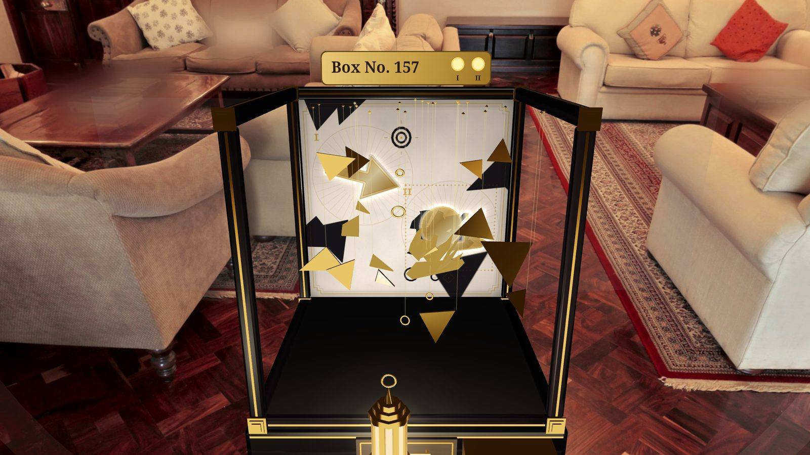
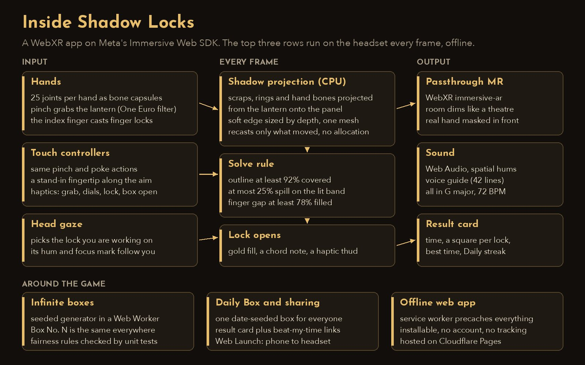

# Shadow Locks

**Infinite hand-tracked mixed reality puzzles for Meta Quest.** Move a lantern until shadows at different depths fill
each lock, cast the missing piece with your own fingertip, solve a new Daily Box every day, and challenge friends to
beat your time.

- **Play:** https://shadowlocks.pages.dev (open it in the Meta Quest browser; no install, no account)
- **Demo video:** https://youtu.be/Ak_oFJQgHYg

A glass puzzle box appears in your lap, in your real room seen through passthrough. Brass scraps hang inside it on
fine threads, each at its own depth. Pinch the lantern and carry it anywhere in 3D: every shadow on the frosted back
panel slides, stretches and blurs at once. Find the one point in space where the shadows fill a lock's outline, and it
opens in gold. Some locks are one piece short, and nothing inside the box can cast it: you raise your real fingertip
into the beam, and your own shadow completes the shape.

## How it plays

- **A lantern you hold freely in 3D.** Pinch it, carry it, let go: it floats where you left it, so you can rest your arm
  and play with one hand.
- **Depth you read from shadows.** Scraps near the light cast big, soft shadows that swing wide as the lantern moves;
  scraps near the panel stay small and sharp.
- **Your fingertip is a puzzle piece.** Finger locks are short exactly one piece; your real finger's shadow fills it.
- **Passthrough with a purpose.** The room dims like a theatre while you solve, and your real hand stays visible in
  front of the box.
- **Infinite boxes.** A seeded generator makes endless boxes that grow trickier; Box No. N is the same for everyone,
  and every box is checked against the same fairness rules by tests.
- **Daily Box and friends.** A new box every day with a streak, a result card for every box, and "beat my time" links
  that open the exact same box for a friend. No accounts, no servers.
- **Hands first, controllers too.** Touch controllers do everything hands do, including finger locks, with haptics.
- **Seated comfort.** The box places itself in your lap from your seated posture, never drifts, and an arrow at the
  edge of your view brings it back with one pinch.
- **Offline, private, six languages.** English, Spanish, French, German, Brazilian Portuguese and Japanese, with an
  English voice guide.

With the lantern a distance D from the back panel, a scrap a distance d from it, a lantern of radius r, and the lantern
moved sideways by Δ:

$$
\text{shadow scale} = \frac{D}{D-d}, \qquad
\text{shadow swing} = \Delta \cdot \frac{d}{D-d}, \qquad
\text{edge blur} = r \cdot \frac{d}{D-d}
$$

Blur and swing share one factor, so the two depth cues always agree.

## How it is built

- TypeScript on Meta's Immersive Web SDK (IWSDK) and three.js, in a WebXR `immersive-ar` session for passthrough.
- Shadows without shadow maps: every scrap, sight ring and hand bone is projected from the lantern onto the panel on
  the CPU each frame, as exact polygons with a depth-sized soft edge, in one mesh, with no per-frame allocation.
- A lock opens when at least 92% of its outline is in shadow, at most 25% of the lit band around it is darkened, and
  for a finger lock at least 78% of the missing piece is filled.
- The box generator runs in a Web Worker; the Daily Box is seeded by the date.
- Web Audio with spatial hums; everything pitched is in G major at 72 BPM.
- A Workbox service worker makes it an installable, offline web app; hosted on Cloudflare Pages.
- About 1,800 unit tests (Vitest) and 39 end-to-end specs (Playwright with Meta's IWER headset emulator on a virtual
  clock), bot players, soak tests and a frame-time budget.

## Development

Builds and browsers never run on a laptop: every npm, tsc, vitest and Playwright command runs in a
container on the build server through `scripts/remote.sh <lane> -- <command>`, for example
`scripts/remote.sh main -- npm test`, `scripts/remote.sh main -- npm run typecheck` or
`scripts/remote.sh main -- npm run build`. End-to-end tests (headless Chromium with the IWER headset
emulator, on a virtual clock) run with `scripts/e2e.sh [spec]`, which needs the `shadowlocks-e2e` image
(`scripts/e2e-image/build.sh`, once); see `tests/e2e/README.md`.

Third-party notices are in `THIRD_PARTY_NOTICES.md`.
